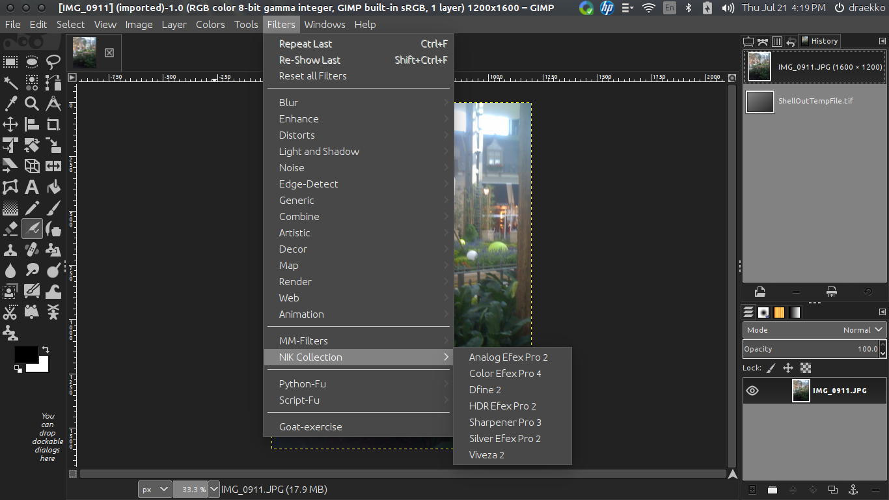
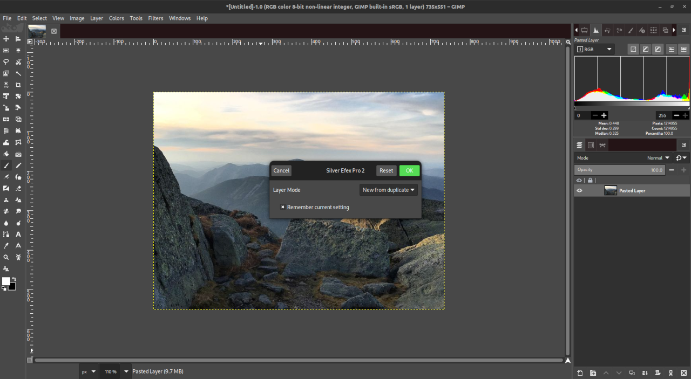
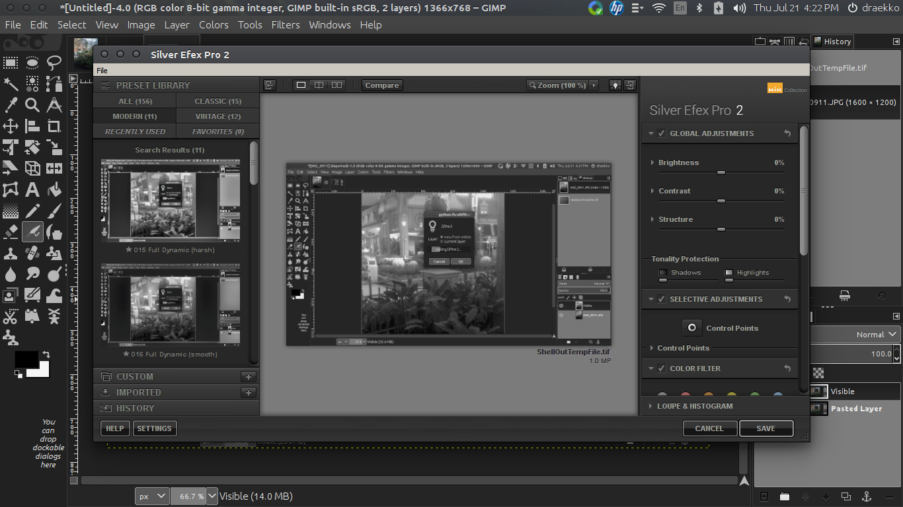

Nik Collection for GIMP v2.10 & v3.0
===

Installation script to install Nik Collection v1.2.11 for use with GIMP (2.10, 3.0, or versions above those) and as a standalone app. 

---

### Donate:

* By sending Bitcoin donations to bc1qeydaauzjpgy3k4mxt47fq4600x0uk9aw3l57am (single/recurring donations)
  

  
### Notes:

* Tested new GIMP plugins on Ubuntu 24.10 with Wine Staging v10.7 using Nik Collection v1.2.11.
* You can use an already downloadeded nikcollection-1.2.11.exe file with the installation script but make sure to use the absolute path when doing so. For example if the file is in home downloads then do something like "/whereitis/install_nik_collection.sh /home/username/Downloads/nikcollection-1.2.11.exe" to have it fetch the file locally instead of trying to download it.
* Depending on your system specs the plugins can take some time to start as they are launched through wine.
* Last update to include the GIMP plugins for v2.10 of GIMP.

### Screenshots:
  

  
  

  
  

  
  
